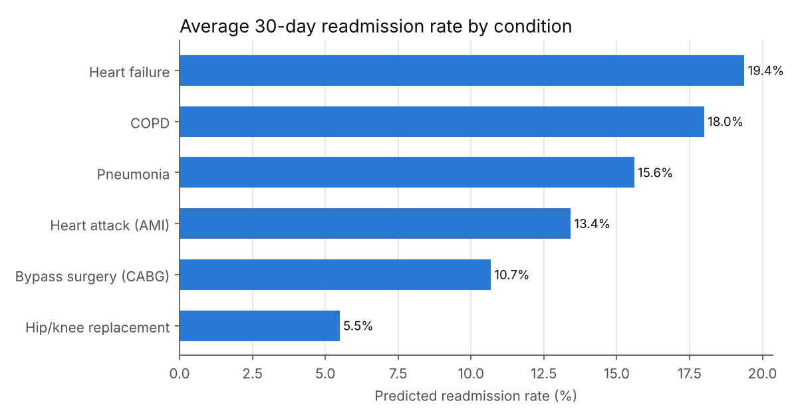
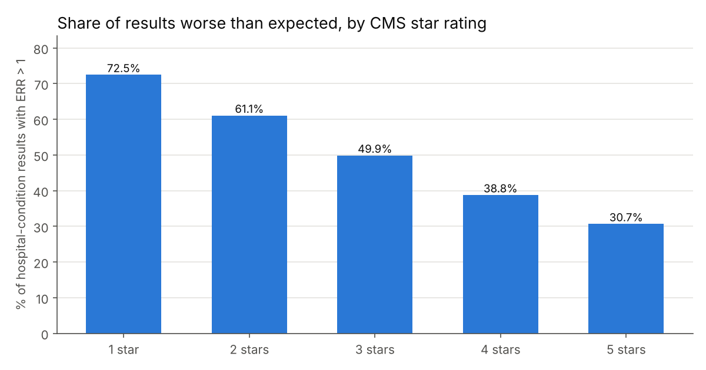
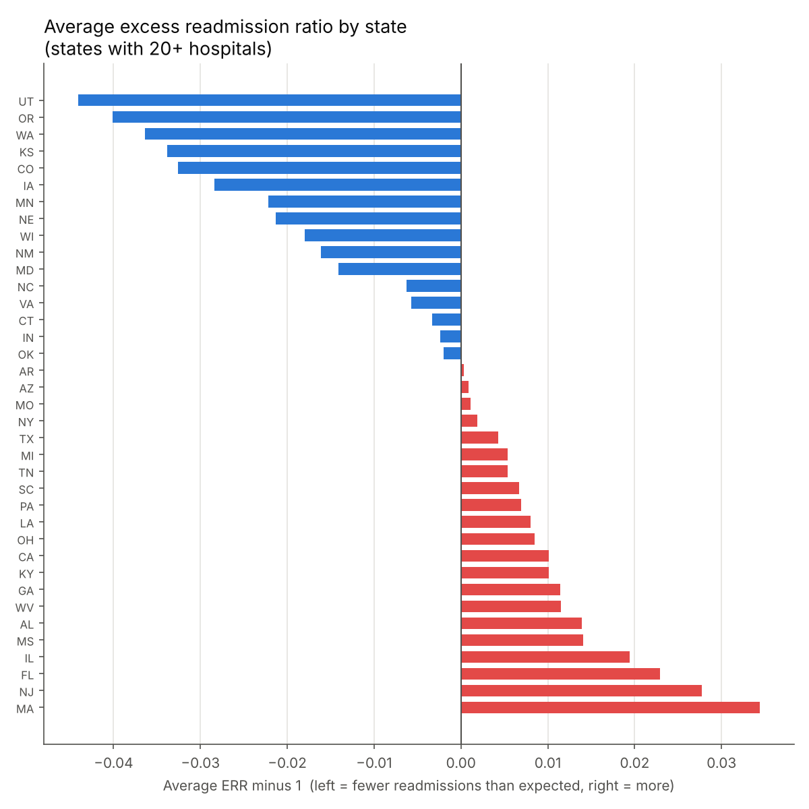
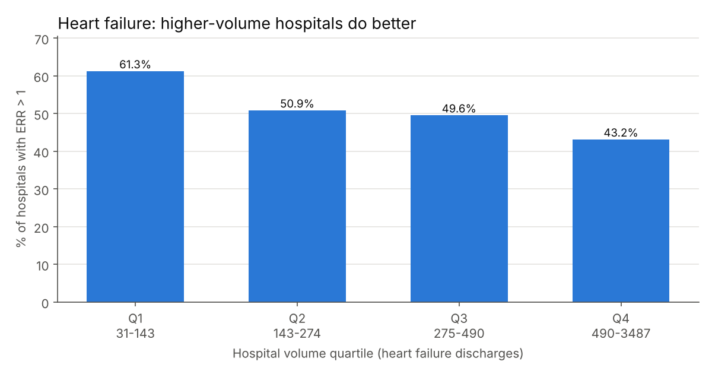

# U.S. Hospital Readmissions Analysis (Python + SQL)

An analysis of real Medicare data on 30-day hospital readmissions for 3,055 U.S. hospitals. The project cleans two public CMS datasets with Python, loads them into a SQL database, and uses SQL to answer questions a hospital quality team or health insurer would ask: which conditions drive readmissions, which hospitals and states perform worse than expected, and whether hospital quality ratings and patient volume are related to readmission performance.

I work in a clinical lab, so I wanted a project with real healthcare data instead of another practice dataset. Readmissions are something hospitals actually get penalized for, which made it a good fit.

**Tools:** Python (pandas, matplotlib), SQL (SQLite), Git

**Data:** [Centers for Medicare & Medicaid Services (CMS), Provider Data Catalog](https://data.cms.gov/provider-data/)
- [Hospital Readmissions Reduction Program (HRRP), FY 2026](https://data.cms.gov/provider-data/dataset/9n3s-kdb3): readmission results for 6 conditions, performance period July 2021 – June 2024
- [Hospital General Information](https://data.cms.gov/provider-data/dataset/xubh-q36u): hospital type, ownership, and CMS overall star rating


## Background

Under the Hospital Readmissions Reduction Program, Medicare reduces payments to hospitals with more 30-day readmissions than expected. The key measure is the **Excess Readmission Ratio (ERR)**:

> **ERR = predicted readmission rate ÷ expected readmission rate**
>
> **ERR > 1** means more readmissions than expected for a hospital with similar patients (worse). **ERR < 1** means fewer (better).


## Findings

**1. Heart failure has the highest readmission rate.** The average hospital's predicted 30-day readmission rate for heart failure is 19.4%, nearly 1 in 5 patients, followed by COPD (18.0%) and pneumonia (15.6%). Hip/knee replacement is lowest at 5.5%.



**2. Most hospitals are worse than expected somewhere.** Of the 2,833 hospitals with at least one reported ERR, **2,358 (83.2%) were above 1 for at least one condition**, and 981 were above 1 for three or more. CMS's actual payment reduction compares each hospital to the median of its peer group, so this is a measure of risk rather than the exact penalty count.

**3. Star ratings line up strongly with readmission performance.** 72.5% of results at 1-star hospitals were worse than expected, falling steadily to 30.7% at 5-star hospitals. Readmissions are one of the five measure groups in the star rating, so part of this link is built in, but the gradient is consistent at every step.



**4. For-profit hospitals do slightly worse.** For-profit hospitals (proprietary and physician-owned) had an average ERR of 1.014, with 54.2% of results worse than expected, compared with 0.998 and 46.1% for non-profit hospitals. Government hospitals fell in between (1.001, 50.0%).

**5. A clear regional pattern.** Among states with 20 or more reporting hospitals, Utah (0.956), Oregon (0.960), and Washington (0.964) had the lowest average ERR. Massachusetts (1.034), New Jersey (1.028), and Florida (1.023) had the highest. Most of the ten best states are in the West and Plains; the ten worst include Massachusetts, New Jersey, and several Southeastern states.



**Closer look at New Jersey.** Within NJ, 40 of 60 hospitals had more heart failure readmissions than expected. Chilton Medical Center (0.80) did best and West Jersey Hospital (1.20) did worst.

**6. Higher-volume hospitals have fewer excess heart failure readmissions.** Splitting hospitals into four equal groups by heart failure discharges, 61.3% of the lowest-volume hospitals (31–143 discharges) were worse than expected, compared with 43.2% of the highest-volume hospitals (490+ discharges).



**7. More than a third of the data can't be used, and it matters why.** 36.1% of hospital-condition results have no ERR: 17.8% because results were not available for the period, 17.2% because there were too few cases to report, and 1.1% because no cases met the criteria. Results suppressed for too few cases come from low-volume hospitals, so the averages here describe mid-size and large hospitals best.


## Questions and Queries

All queries are in [`sql/queries.sql`](sql/queries.sql), and each result is saved in [`results/`](results).

| # | Question | SQL techniques |
|---|---|---|
| 1 | How much of the data is usable, and why is the rest missing? | `LEFT JOIN` to a footnote lookup table, subquery for percentages |
| 2 | Which conditions have the highest readmission rates? | Aggregation, conditional counts (`SUM(CASE WHEN ...)`) |
| 3 | How many hospitals are worse than expected for at least one condition? | Common table expression (CTE), two-level aggregation |
| 4 | Do higher star ratings mean fewer excess readmissions? | Multi-table `JOIN`, `COALESCE` for unrated hospitals |
| 5 | Do for-profit, non-profit, and government hospitals differ? | `CASE` to group 12 ownership types into 4 |
| 6 | Which states perform best and worst? | `HAVING` minimum sample size, `RANK()` window function |
| 7 | Does patient volume affect heart failure readmissions? | `NTILE(4)` window function for quartiles |
| 8 | Which large hospitals have the lowest and highest heart failure ERR? | Two `RANK()` windows in one query |
| 9 | How do New Jersey hospitals rank on heart failure? | `RANK()` within one state, `LEFT JOIN` for city |


## Data Cleaning

[`build_database.py`](build_database.py) turns the raw CMS files into an analysis-ready SQLite database:

- Renames columns to consistent `snake_case`
- Converts CMS placeholder text ("Not Available", "Too Few to Report") to proper `NULL` values so numeric columns can be stored as numbers
- Converts dates from `MM/DD/YYYY` to ISO `YYYY-MM-DD`
- Maps measure codes such as `READM-30-HF-HRRP` to readable condition names
- Adds a `footnotes` lookup table with CMS's official footnote text
- Enforces a schema with primary keys and a `CHECK` constraint on star ratings (1–5)

| Table | Rows | Description |
|---|---|---|
| `hospitals` | 5,419 | One row per Medicare-registered hospital |
| `readmissions` | 18,330 | One row per hospital per condition (3,055 hospitals × 6 conditions) |
| `footnotes` | 9 | CMS footnote codes used in the data and their meaning |


## Limitations

- **Risk-adjusted, not raw:** predicted and expected rates come from CMS's risk models; this project analyzes them as published.
- **Suppressed data:** results for hospitals with too few cases are not reported, which leaves out many small hospitals (see finding 7).
- **Unmatched hospitals:** 20 hospitals in the readmissions file (120 rows) are not in the general information file, so they are excluded from the star rating and ownership comparisons.
- **Maryland:** Maryland hospitals appear in the data but are waived from HRRP payment adjustments under the state's own payment model.
- **Correlation, not causation:** for example, the volume finding does not show that higher volume causes better results.


## Project Structure

```
├── data/
│   └── raw/
│       ├── hospital_general_info.csv   # CMS Hospital General Information
│       └── hrrp_fy2026.csv             # CMS HRRP FY 2026
├── sql/
│   └── queries.sql                     # 9 business-question queries
├── build_database.py                   # cleans raw data -> hospitals.db
├── run_analysis.py                     # runs queries -> results/ and images/
├── results/                            # CSV output of each query
├── images/                             # charts
├── requirements.txt
└── README.md
```

## How to Run

```bash
pip install -r requirements.txt
python3 build_database.py   # creates hospitals.db and data/clean/
python3 run_analysis.py     # writes results/ and images/
```


## Related Projects

- [E-Commerce SQL Analysis](https://github.com/Pdhruv1512/ecommerce-sql-analysis)
- [PostgreSQL Database Design & Administration](https://github.com/Pdhruv1512/ecommerce-postgres-dba)
- [E-Commerce Sales Dashboard (Tableau)](https://github.com/Pdhruv1512/ecommerce-sales-dashboard)
